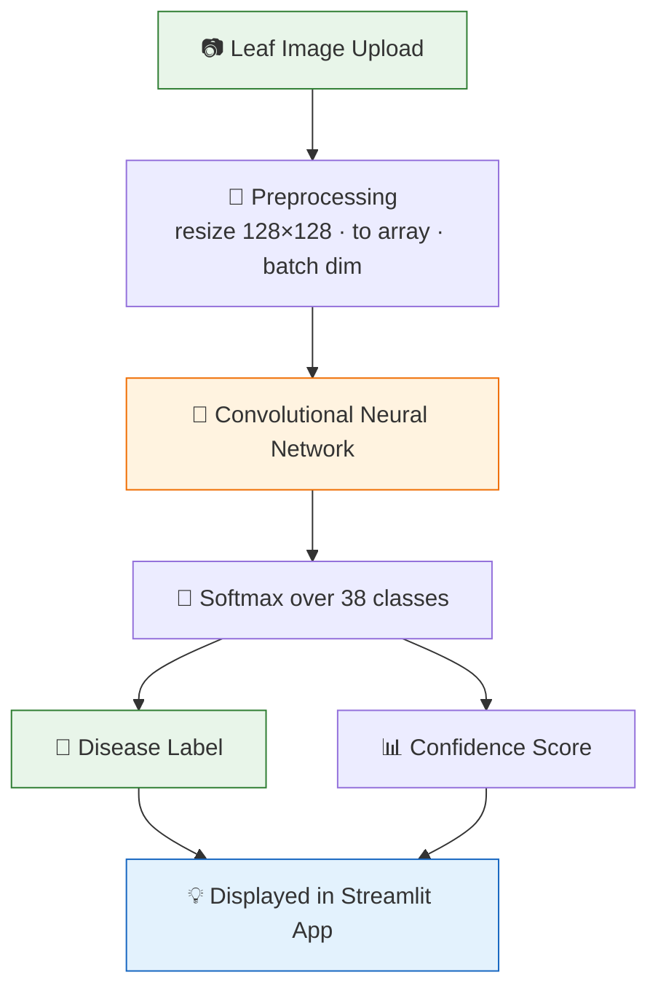

<div align="center">


# 🌿 Plant Disease Detection

### Leaf Image Classification · Convolutional Neural Network · Streamlit Web App

*A deep-learning system that identifies plant diseases from leaf photographs,*
*built to support early intervention and reduce crop loss.*

<br>


<br>

**🌾 Healthy leaves in. Diagnoses out.**

</div>

---

## 📑 Contents

| | | |
|:---|:---|:---|
| 🔍 [Overview](#-overview) | 🧬 [Model Architecture](#-model-architecture) | ⚙️ [Installation](#️-installation) |
| ⚡ [Quick Facts](#-quick-facts) | 📊 [Training & Results](#-training--results) | ▶️ [Running the Project](#️-running-the-project) |
| ✨ [Features](#-features) | 🛠️ [Tech Stack](#️-tech-stack) | 🖥️ [Using the App](#️-using-the-app) |
| 🔄 [Pipeline](#-pipeline) | 📁 [Repository Structure](#-repository-structure) | ⚠️ [Limitations](#️-limitations) |
| 🗂️ [Dataset](#️-dataset) | 🔐 [Notes & Good Practice](#-notes--good-practice) | 🔮 [Future Work](#-future-work) |

---

## 🔍 Overview

**Plant Disease Detection** is a computer-vision project that takes a photograph of a plant leaf and predicts which disease (or healthy state) it shows. A Convolutional Neural Network is trained from scratch on the PlantVillage leaf-image dataset, then wrapped in a lightweight Streamlit web app so a user can upload an image and receive a diagnosis in seconds.

The goal is practical: crop diseases are far cheaper to treat when caught early, and most farmers don't have a plant pathologist on call. An image classifier on a phone or laptop can act as a first-pass screening tool.

> [!NOTE]
> **Scope:** The model classifies a **single leaf image** into **one of 38 categories** (crop + disease, or crop + healthy). It does not detect pests, nutrient deficiencies, or multiple diseases in the same image, and it does not localise *where* on the leaf the disease is.

---

## ⚡ Quick Facts

| | |
|:---|:---|
| **Task type** | Multi-class image classification (single label) |
| **Input** | RGB leaf image, resized to 128 × 128 × 3 |
| **Output** | Predicted class label + softmax confidence |
| **Model** | Custom sequential CNN (5 convolutional blocks + dense head) |
| **Dataset** | PlantVillage — *New Plant Diseases Dataset (Augmented)* on Kaggle |
| **Train / Validation** | ≈ 70,295 / 17,572 images (dataset's pre-made split) |
| **Epochs** | 10 |
| **Optimizer** | Adam, learning rate 1e-4 |
| **Loss** | Categorical cross-entropy |
| **Saved artifact** | `trained_plant_disease_model.keras` |

---

## ✨ Features

| Feature | Description |
|:---|:---|
| 🍃 Leaf disease classification | Identifies 38 crop/disease combinations across 14 crop species |
| 🧠 Custom CNN | Trained from scratch — no pretrained backbone required |
| 🎨 Data augmentation | Uses the pre-augmented Kaggle split (flips, rotations, zoom, shifts) |
| 📈 Training visualisation | Accuracy and loss curves plotted per epoch in the notebook |
| 🎯 Confidence output | Softmax probabilities for every class; top prediction shown |
| 📉 Confusion matrix | Per-class evaluation on the validation set |
| 🖼️ Image upload UI | Streamlit page with drag-and-drop upload and instant prediction |
| 💾 Model persistence | Trained weights saved to `.keras` and loaded by the app at startup |

---

## 🔄 Pipeline



<details>
<summary><b>📄 Plain-text version (if Mermaid doesn't render)</b></summary>

```text
Leaf image
    │
    ▼
Preprocessing → resize to 128×128 → convert to array → add batch dimension
    │
    ▼
Convolutional Neural Network (5 conv blocks → flatten → dense)
    │
    ▼
Softmax over 38 classes
    │
    ▼
Predicted label + confidence → shown in the Streamlit app
```

</details>

---

## 🗂️ Dataset

| Property | Value |
|:---|:---|
| **Name** | New Plant Diseases Dataset (Augmented) — derived from PlantVillage |
| **Source** | [Kaggle](https://www.kaggle.com/datasets/vipoooool/new-plant-diseases-dataset) |
| **Total images** | ≈ 87,000 |
| **Classes** | 38 (14 crops; healthy + diseased leaves) |
| **Image format** | JPG, RGB, resized to 128 × 128 for training |
| **Folder layout** | `train/<class_name>/`, `valid/<class_name>/`, `test/` |

<details>
<summary><b>🌱 Full class list (38)</b></summary>

| # | Crop | Condition |
|--:|:---|:---|
| 1 | Apple | Apple scab |
| 2 | Apple | Black rot |
| 3 | Apple | Cedar apple rust |
| 4 | Apple | Healthy |
| 5 | Blueberry | Healthy |
| 6 | Cherry | Powdery mildew |
| 7 | Cherry | Healthy |
| 8 | Corn (maize) | Cercospora leaf spot / Gray leaf spot |
| 9 | Corn (maize) | Common rust |
| 10 | Corn (maize) | Northern leaf blight |
| 11 | Corn (maize) | Healthy |
| 12 | Grape | Black rot |
| 13 | Grape | Esca (Black measles) |
| 14 | Grape | Leaf blight (Isariopsis leaf spot) |
| 15 | Grape | Healthy |
| 16 | Orange | Huanglongbing (Citrus greening) |
| 17 | Peach | Bacterial spot |
| 18 | Peach | Healthy |
| 19 | Pepper (bell) | Bacterial spot |
| 20 | Pepper (bell) | Healthy |
| 21 | Potato | Early blight |
| 22 | Potato | Late blight |
| 23 | Potato | Healthy |
| 24 | Raspberry | Healthy |
| 25 | Soybean | Healthy |
| 26 | Squash | Powdery mildew |
| 27 | Strawberry | Leaf scorch |
| 28 | Strawberry | Healthy |
| 29 | Tomato | Bacterial spot |
| 30 | Tomato | Early blight |
| 31 | Tomato | Late blight |
| 32 | Tomato | Leaf mold |
| 33 | Tomato | Septoria leaf spot |
| 34 | Tomato | Spider mites (Two-spotted spider mite) |
| 35 | Tomato | Target spot |
| 36 | Tomato | Tomato yellow leaf curl virus |
| 37 | Tomato | Tomato mosaic virus |
| 38 | Tomato | Healthy |

</details>

> [!IMPORTANT]
> The dataset is **not** committed to this repository because of its size (several GB). Download it from Kaggle, extract it, and place the `train/` and `valid/` folders at the path the notebook expects — or update the path variables at the top of the notebook. Check the dataset's licence before redistributing any images.

---

## 🧬 Model Architecture

The network is a plain sequential CNN built with Keras. Each block doubles the filter count and halves the spatial size.

| Stage | Layers | Output shape |
|:---|:---|:---|
| Input | — | 128 × 128 × 3 |
| Block 1 | Conv2D(32) → Conv2D(32) → MaxPool(2) | 64 × 64 × 32 |
| Block 2 | Conv2D(64) → Conv2D(64) → MaxPool(2) | 32 × 32 × 64 |
| Block 3 | Conv2D(128) → Conv2D(128) → MaxPool(2) | 16 × 16 × 128 |
| Block 4 | Conv2D(256) → Conv2D(256) → MaxPool(2) | 8 × 8 × 256 |
| Block 5 | Conv2D(512) → Conv2D(512) → MaxPool(2) | 4 × 4 × 512 |
| Regularisation | Dropout(0.25) → Flatten | 8192 |
| Dense head | Dense(1500, ReLU) → Dropout(0.4) | 1500 |
| Output | Dense(38, Softmax) | 38 |

All convolutions use 3 × 3 kernels with ReLU activation. The two dropout layers are the only regularisation; there is no batch normalisation and no pretrained weights.

```text
Image ─► [Conv·Conv·Pool] ×5 ─► Dropout ─► Flatten ─► Dense(1500) ─► Dropout ─► Dense(38, softmax)
```

---

## 📊 Training & Results

| Setting | Value |
|:---|:---|
| Optimizer | Adam (lr = 0.0001) |
| Loss | Categorical cross-entropy |
| Batch size | 32 |
| Epochs | 10 |
| Metric | Accuracy |

Results reported in the notebook after the final epoch:

| Metric | Value |
|:---|:---|
| Training accuracy | ≈ 97% |
| Validation accuracy | ≈ 95% |
| Validation loss | ≈ 0.15 |

The notebook also plots accuracy/loss curves across epochs and produces a 38 × 38 confusion matrix on the validation set.

> [!WARNING]
> **Read the numbers carefully.**
> - PlantVillage images are **lab-shot leaves on plain backgrounds**. Real field photos — with soil, shadows, other plants, or a hand holding the leaf — will perform noticeably worse than the validation figure suggests.
> - The validation split is drawn from the **same source distribution** as training, so it measures how well the model learned PlantVillage, not how well it generalises to new cameras or conditions.
> - Classes are **not perfectly balanced**; overall accuracy can hide weak recall on the smaller classes. Check the per-class confusion matrix before trusting any one disease prediction.
> - Confidence scores are raw softmax outputs. They are **not calibrated** — a 99% score does not mean the model is right 99% of the time.

---

## 🛠️ Tech Stack

| Layer | Technology |
|:---|:---|
| Language | Python 3.x |
| Deep learning | TensorFlow / Keras |
| Image handling | Keras `image_dataset_from_directory`, Pillow |
| Numerics & plots | NumPy, Matplotlib, Seaborn |
| Evaluation | scikit-learn (classification report, confusion matrix) |
| Web / UI | Streamlit |
| Notebook | Jupyter |
| Version control | Git, GitHub |

---

## 📁 Repository Structure

```text
plant-disease-detection/
├── README.md
├── .gitignore
├── requirements.txt
├── Train_plant_disease.ipynb        # data loading, model, training, evaluation
├── Test_plant_disease.ipynb         # load saved model, predict on single images
├── main.py                          # Streamlit app
├── trained_plant_disease_model.keras   # saved weights (may be git-ignored if large)
├── training_hist.json               # per-epoch accuracy / loss
└── home_page.jpeg                   # app banner image
```

| File | Role |
|:---|:---|
| `Train_plant_disease.ipynb` | Builds the dataset pipeline, defines the CNN, trains for 10 epochs, plots curves, saves the model |
| `Test_plant_disease.ipynb` | Loads the saved model and runs a prediction on a chosen image, showing the class name |
| `main.py` | Streamlit front end: Home · About · Disease Recognition pages |
| `trained_plant_disease_model.keras` | Artifact loaded by `main.py`; must exist before launching the app |

> [!TIP]
> If the `.keras` file exceeds GitHub's 100 MB limit, keep it out of the repo (add it to `.gitignore`) and document where to download it, or use Git LFS.

---

## ⚙️ Installation

**1 — Clone**

```bash
git clone https://github.com/krishnachaitanya941/plant-disease-detection.git
cd plant-disease-detection
```

**2 — Virtual environment**

```powershell
# Windows PowerShell
python -m venv .venv
.venv\Scripts\Activate.ps1
```

```bash
# macOS / Linux
python -m venv .venv
source .venv/bin/activate
```

**3 — Dependencies**

```bash
pip install tensorflow numpy pandas matplotlib seaborn scikit-learn pillow streamlit notebook
```

Or, if a `requirements.txt` is present:

```bash
pip install -r requirements.txt
```

**4 — Dataset**

Download the *New Plant Diseases Dataset (Augmented)* from Kaggle, extract it, and make sure the `train/` and `valid/` directories match the paths used in `Train_plant_disease.ipynb`.

---

## ▶️ Running the Project

### Train the model

```bash
jupyter notebook
```

Open `Train_plant_disease.ipynb` and run all cells top to bottom. Training on CPU takes a long time — a GPU (local or Google Colab) is strongly recommended. The notebook writes `trained_plant_disease_model.keras` and `training_hist.json` on completion.

### Test a single image

Open `Test_plant_disease.ipynb`, set the image path in the prediction cell, and run it. The notebook prints the predicted class name and displays the image.

### Launch the web app

```bash
streamlit run main.py
```

Streamlit prints a local URL (normally `http://localhost:8501`). Open it in your browser.

> [!NOTE]
> `main.py` loads the `.keras` model at startup. If the file is missing or at a different path, the app will raise an error before the page renders — train the model or download the artifact first.

---

## 🖥️ Using the App

1. Open the **Disease Recognition** page from the sidebar.
2. Click **Browse files** and choose a leaf photo (JPG/PNG).
3. Click **Show Image** to preview the upload.
4. Click **Predict**. The app displays the predicted crop and disease name.

For best results, photograph a **single leaf, well lit, filling most of the frame, on a plain background** — this matches the conditions the model was trained on.

---

## 🔐 Notes & Good Practice

- **Paths:** Dataset and model paths are hard-coded in the notebooks and `main.py`. Update them if your folder layout differs.
- **Reproducibility:** Training does not fix a random seed, so re-running will give slightly different accuracy figures.
- **Large files:** Keep the dataset and (ideally) the model weights out of Git history.
- **Memory:** `image_dataset_from_directory` streams batches from disk, so the full dataset is never loaded into RAM — but the model itself is large (~7–8 M parameters in the dense layer alone).

---

## ⚠️ Limitations

- Predicts **one label per image** — cannot flag co-occurring diseases.
- Trained only on **lab-background PlantVillage images**; accuracy on field photos is untested and expected to be lower.
- Covers **14 crops only**. Any other plant will be forced into one of the 38 classes with a misleading confidence score.
- No detection of **pests, nutrient deficiency, drought stress, or mechanical damage**.
- No **localisation** — the model says *what*, not *where*.
- Softmax confidence is **not a calibrated probability**.

> [!CAUTION]
> This tool is an **educational prototype**. Predictions should not be used as the sole basis for pesticide application or crop-management decisions. Always confirm a diagnosis with a local agricultural extension officer or plant pathologist.

---

## 🔮 Future Work

- [ ] Add **Grad-CAM** heatmaps to show which leaf region drove the prediction
- [ ] Evaluate on **real field photographs** (e.g. the PlantDoc dataset) and report the drop
- [ ] Compare the custom CNN against **MobileNetV2 / EfficientNet** transfer learning
- [ ] Add **batch normalisation** and an early-stopping callback
- [ ] Report **macro-F1 and per-class precision/recall** alongside accuracy
- [ ] Export to **TensorFlow Lite** for offline use on low-end phones
- [ ] Attach a **treatment-recommendation** lookup for each predicted disease
- [ ] Fix random seeds and add a `requirements.txt` with pinned versions
- [ ] Deploy to **Streamlit Community Cloud** or Hugging Face Spaces

These are planned improvements, not claims about current functionality.

---

## 🤝 Contributing

1. Fork the repository
2. Create a branch — `git checkout -b feature/your-feature`
3. Commit — `git commit -m "Describe your change"`
4. Push — `git push origin feature/your-feature`
5. Open a pull request

Please don't commit dataset files, oversized model weights, or any credentials.

---

## 🙏 Acknowledgements

- The **PlantVillage** project and the Kaggle *New Plant Diseases Dataset (Augmented)* contributors for the training data
- The open-source maintainers of TensorFlow, Keras, NumPy, Matplotlib, scikit-learn, and Streamlit

---

## 👤 Author

**Krishna Chaitanya**

<a href="https://github.com/krishnachaitanya941">
  
</a>
<a href="https://github.com/krishnachaitanya941/plant-disease-detection">
  
</a>

---

<div align="center">

### 🌱 Better diagnosis. Healthier crops.

*Built with Python, deep learning, and computer vision.*

⭐ **Found this useful? Star the repository.**

</div>
